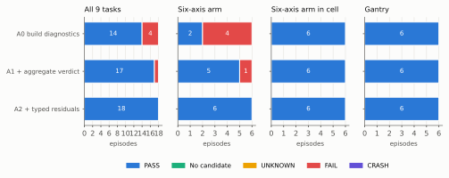

# FORGE: Evidence-Linked Robot Design, Verification, and Manufacturing Evaluation

**Suneet Dungrani · Independent Researcher**  
**Preprint · Not peer reviewed**

[Research paper](papers/current/FORGE_Research_Paper.pdf) · [Technical supplement](papers/current/FORGE_Technical_Supplement.pdf) · [Reproduction guide](docs/REPRODUCIBILITY.md) · [Publication downloads](https://github.com/suneetdungrani2/forge-systems-publication/releases/tag/preprint-materials) · [Publication website](https://suneetdungrani2.github.io/forge-systems-publication/)

Forge connects written robotics requirements to editable parametric designs. It records scoped checks, simulation results, and revisions against the designs that produced them. This study evaluates a geometry checker on known-answer cases, compares feedback conditions in a controlled design-repair study, measures fixture placement and gantry transfer in simulation, and estimates manufacturing effects in a discrete-event model.

## Findings

| Evaluation | What the evidence supports |
| --- | --- |
| Geometry verification | The whole-part screen and the feature-scoped checker use different truth definitions. Their false-acceptance counts cannot establish relative checker performance. |
| Design repair | The three conditions passed **14/18**, **17/18**, and **18/18** held-out evaluations. Ten episodes changed from a first failing design to a passing selected revision. The comparison did not establish that structured feedback improved repair. |
| Fixture placement | The original and revised fixtures achieved **96/100** and **100/100** simulated placements under the reference approach. The study changed two geometric features together. Contact and numerical sensitivity limit the result. |
| Gantry transfer | Planned motion decreased from **21.760 s** to approximately **7.474 s**. Successful simulated transfers changed from **59/100** to **58/100**. Transfer reliability did not improve. |
| Manufacturing | The four-condition comparison estimates effects under a fixed operation envelope in the specified production model. |



The evidence covers software checks, conditional simulation, and production modeling. It does not validate a physical robot, a physical fixture, or factory throughput. The manuscripts identify the evaluated AI model and agent configuration.

## Research materials

- [LaTeX, bibliography, tables, and figures](papers/current/paper/)
- [Frozen experimental records](data/) and [analysis code](analysis/)
- [Manuscript claim map](papers/current/PAPER_CLAIM_EVIDENCE_MAP.csv) and [source provenance](provenance/source-inventory.json)
- [Reviewer website source](reviewer/) and [local viewing instructions](reviewer/README.md)

The publication ZIP includes the complete site and all three films. The standalone website ZIP includes both PDFs, the evidence guide, captions, and films. Extract either ZIP before opening the site. The Git checkout contains the site source and excludes the MP4s.

## Reproduce the analysis

Tier A uses the included frozen records to run the analysis tests, regenerate results, and rebuild both manuscripts. Install the tools in the [reproduction guide](docs/REPRODUCIBILITY.md), then run:

```sh
uv sync --frozen
uv run --frozen python scripts/reproduce.py --out ../forge-reproduction
```

Tier B is an optional replay of one selected fixture pair. It requires 38 checksum-matched meshes supplied separately with permission. Tier C, including full design generation and simulation, requires proprietary Forge components outside this package.

## Cite and reuse

Dungrani, S. (2026). *FORGE: Evidence-Linked Robot Design, Verification, and Manufacturing Evaluation*. Preprint.

Machine-readable citation metadata is in [CITATION.cff](CITATION.cff). See the [rights and third-party notices](THIRD_PARTY_NOTICES.md) before reusing code, data, images, or media. Contact [Suneet Dungrani](mailto:suneetdungrani@utexas.edu) about permissions.
